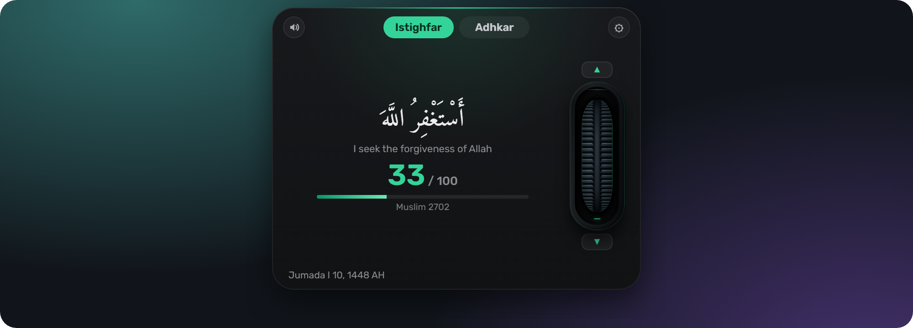
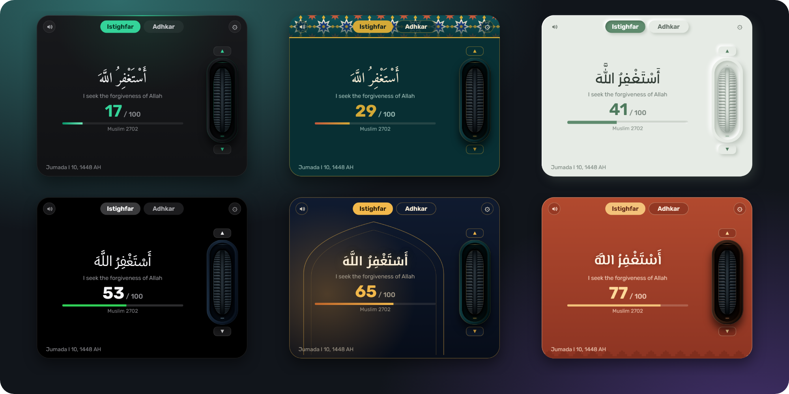
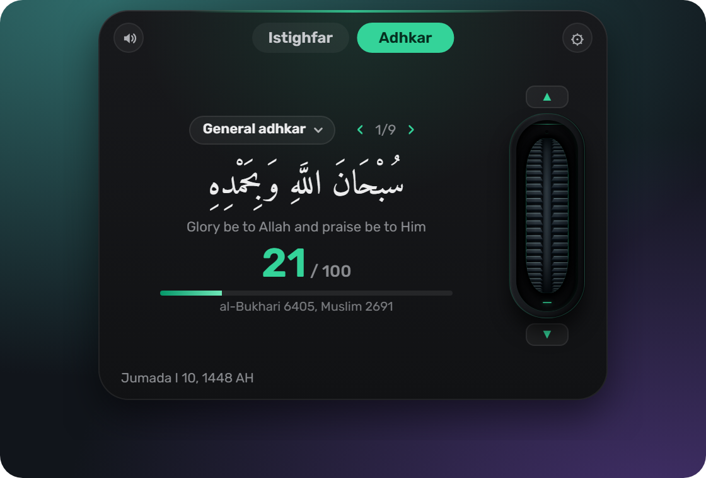
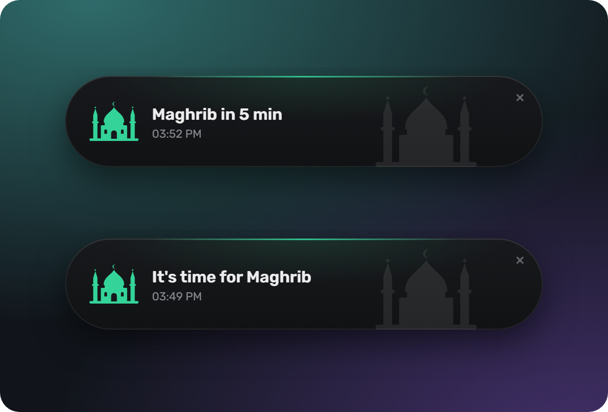
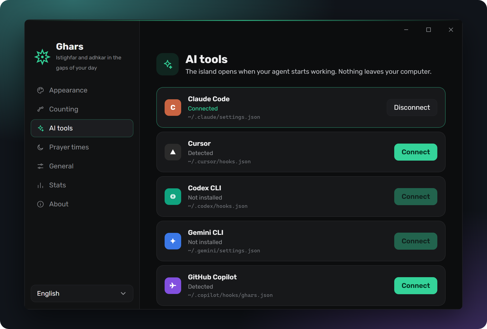

<b>English</b> · <a href="README.ar.md">العربية</a>

<h1 align="center">غرس · Ghars</h1>

  <b>Remember Allah in the small gaps of your day.</b> 
  A small island at the top of your screen for istighfar and adhkar. 
  Free, private, and works offline.

  <a href="https://github.com/saif-o99/ghars/releases/latest"><b>⬇ Download for Windows, macOS and Linux</b></a>

## What is Ghars?

Your day is full of short waits: a page loading, a file copying, an AI agent writing code.
Ghars turns those moments into dhikr. Move your mouse over the island and it opens.
Scroll, and every notch is one count.

The name means *planting*, from the hadith that whoever says *SubhanAllahil-'Azim wa bihamdihi*
has a palm tree planted for them in Jannah (at-Tirmidhi 3464).

## What you can do

- **Count istighfar** toward a daily goal you set.
- **Read the adhkar** for morning, evening, after prayer and Friday. Each one shows its source
  (hadith or ayah). Or add your own.
- **Hear the pronunciation** of each dhikr, to help you say it correctly.
- **See prayer times and the Hijri date**, with a quiet reminder before each prayer.
- **Make it yours** with 17 themes, from simple dark to zellige, Iznik tile and manuscript.
- **Use it in your language:** العربية, English, اردو, Bahasa Indonesia, Bahasa Melayu, Türkçe,
  Français, বাংলা.
- **Look back** at your counts for today, this week and this month.

  
  

## Stays out of your way

- Clicks pass straight through everywhere except the island itself.
- It can hide while you watch a video or present in full screen.
- Pause it for 30 minutes, an hour, or set quiet hours every day.

## Made for people who work with AI

If you use **Claude Code, Cursor, Codex, Gemini CLI or GitHub Copilot**, Ghars opens by itself
while the agent is working, so the waiting time becomes remembrance.
Turn it on in **Settings → AI tools → Connect**. One click per tool.
[More about AI tools](docs/AI-TOOLS.md)

## Private by design

- No account, no ads, no tracking.
- Your counts never leave your computer.
- The only thing Ghars does online is check for a new version once a day.
  You can turn that off in Settings → About.

## Install

**Windows:** download the file ending in `-setup.exe` and run it.
If Windows shows "Windows protected your PC", click **More info → Run anyway**.
This appears because the app isn't signed for Windows yet.

**macOS:** download the `.dmg` (`aarch64` for Apple silicon M1 and newer, `x64` for Intel Macs)
and drag Ghars into Applications. The app is signed and checked by Apple.

**Linux:** use the `.AppImage`, `.deb` or `.rpm`.
See [platform notes](docs/PLATFORMS.md) for what works on Wayland.

Ghars lives in the system tray (the menu bar on Mac). Settings open the first time you start it.
New versions install themselves when you choose to update from the tray menu.

## How to use it

1. **Open:** move your mouse over the island, or press `Alt+Shift+G` (`⌘⌥G` on Mac).
2. **Count:** scroll, drag the wheel, or press ↑. ↓ takes one back.
3. **Close:** move the mouse away, press Esc, or click ×.
4. **Settings and pause:** from the Ghars icon in the tray or menu bar.

## Questions

**Is it free?** Yes, and it always will be. It's open source under the MIT license.

**Do I need AI tools to use it?** No. Ghars works on its own. Opening while your AI agent works
is an extra you can turn on if you use one.

**Does it work without internet?** Yes. Everything works offline, including prayer times.
Only the daily check for a new version needs a connection.

**I don't read Arabic well. Is it for me?** Yes. Every dhikr shows its meaning in your language,
and you can listen to how it's pronounced.

**How do I keep my counts when I change computers?** In **Settings → Stats**, click
**Export backup**. On the new computer, open the same page and click **Restore backup**.

**Where do the texts come from?** From *Hisn al-Muslim*, with the reference shown for each dhikr.
The pronunciation audio is computer-generated and is being reviewed by native Arabic speakers.

**I found a mistake.** Please [open an issue](https://github.com/saif-o99/ghars/issues)
with the item and the reference. Corrections from people of knowledge are very welcome.

## Help improve Ghars

- Review a translation in your language.
- Report a mistake in a text or its reference.

## License

[MIT](LICENSE). Fonts from [Fontsource](https://fontsource.org) under the SIL Open Font License.
